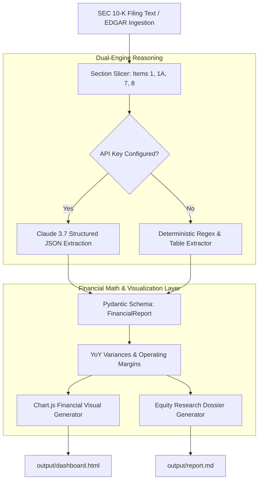

# 📈 SEC Financial Analyst Agent — Operational Playbook
PLAYBOOK.md — Quantitative Equity Research & 10-K Analysis SOP

This playbook defines the standardized workflow, financial metric calculations, risk assessment criteria, and reporting standards for the **SEC Financial Analyst Agent**.

---

## 1. 💼 Executive Overview & Business Case

### The Problem
Equity research analysts, investment bankers, and CFO offices spend **40+ hours per quarterly earnings cycle** combing through 100+ page SEC 10-K and 10-Q filings to extract financial tables, calculate Year-over-Year (YoY) variances, analyze sentiment tone, and evaluate Risk Factors (Item 1A).

### The Automated Solution
An autonomous financial analyst agent that ingests raw SEC 10-K filings, performs live Claude structured JSON metric extraction, computes deterministic YoY percentage changes, constructs risk severity matrix distributions, and outputs an interactive **Chart.js visual dashboard** and **Markdown equity dossier**.

### Quantified ROI & Value
* **Analysis Time**: Reduces 10-K preliminary review from **4 hours per filing to < 5 seconds**.
* **Mathematical Accuracy**: Eliminates manual spreadsheet calculation errors via deterministic Pydantic metric validation.
* **Multi-Sector Versatility**: Pre-configured for **Technology/SaaS**, **Biotech/Pharma**, and **E-Commerce/Retail**.

---

## 2. 🏗️ System Architecture & Financial Pipeline

---

## 3. 📋 Standard Operating Procedures (SOP)

### SOP-01: Financial Metric Extraction & Calibration
The agent strictly targets and extracts 4 core fiscal dimensions across current and prior years:
1. **Total Revenue / Top-Line Growth**: $R_{current}$ vs. $R_{prior}$.
2. **Operating Expenses (OpEx)**: R&D, SG&A, and direct fulfillment costs.
3. **Net Income / Bottom-Line Margin**: Profitability and earnings quality.
4. **Operating Cash Flow (OCF)**: Cash generation from primary operating activities.

### SOP-02: YoY Percentage Formula Enforcement
All percentage changes must follow the standard financial formula:
$$\text{YoY \% Change} = \left( \frac{\text{Metric}_{t} - \text{Metric}_{t-1}}{\text{Metric}_{t-1}} \right) \times 100$$

### SOP-03: Risk Factor Severity Categorization (Item 1A)
Risk factors extracted from the filing are triaged into 3 severity tiers:
* 🔴 **High Severity**: Direct regulatory scrutiny, patent expirations, active litigation, or supply chain failure.
* 🟡 **Medium Severity**: Foreign exchange volatility, interest rate exposure, or competitive pricing pressure.
* 🟢 **Low Severity**: Routine macroeconomic shifts or standard seasonal sales fluctuations.

---

## 4. 🛡️ Guardrails, Security & Compliance

* **Audit-Ready Determinism**: The LLM extracts the reported numbers, but Python computes the YoY percentages and totals to prevent mathematical hallucination.
* **Strict Pydantic Enforcer**: Guarantees that every generated report adheres to `FinancialReport`, `MetricItem`, and `RiskItem` schemas.
* **Non-Investment Advice Disclaimer**: Standard compliance footer automatically embedded in all HTML and Markdown outputs.

---

## 5. 🚨 Human-in-the-Loop Review Triggers

| Trigger Condition | Automated Action | Analyst Action |
| :--- | :--- | :--- |
| **YoY Revenue Drop > 20%** | Highlights card in amber with warning badge | Analyst conducts deep dive into Item 7 MD&A disclosures. |
| **Negative Operating Cash Flow** | Triggers burn rate analysis warning | Analyst inspects working capital and debt maturities. |
| **High-Risk Regulatory Threat** | Flags in executive summary | Legal & Compliance teams notified for risk assessment. |

---

## 6. 🚀 Deployment & Operational Checklist

- [ ] **Dependencies**: `pip install -r requirements.txt` (pydantic, jinja2, rich, anthropic, pytest).
- [ ] **Environment**: Set `ANTHROPIC_API_KEY` in `.env` (or leave empty for offline testing).
- [ ] **Sector Filings**: Select sector via CLI (`--sample techcorp`, `--sample healthplus`, or `--sample retailhub`).
- [ ] **Run Test Suite**: `pytest tests/` (verify 100% test pass rate).
- [ ] **Generate Reports**: `py app.py --sample techcorp` (opens interactive HTML dashboard in browser).

---

## 7. 💬 Stakeholder FAQ

**Q: Can this agent analyze non-standard financial filings?**  
*A: Yes. The dual-engine parser adapts to varying SEC reporting layouts, extracting financial tables regardless of whether the company reports in thousands, millions, or billions.*

**Q: Where do the Chart.js visual graphics come from?**  
*A: The agent dynamically injects extracted metrics directly into a Chart.js script embedded in `output/dashboard.html` with zero external server dependencies.*
